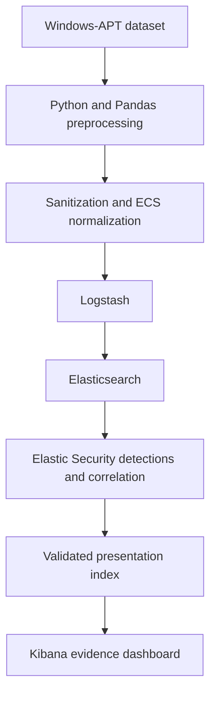

# ATTACK-Correlator

**Correlated Detection of MITRE ATT&CK Sub-Techniques Using Elastic Security and Windows-APT 2025**

## 1. Objective and current status

Build a reproducible local pipeline that uses existing Windows-APT telemetry to detect
**exactly three evidence-supported ATT&CK sub-techniques**, correlate related events,
and present detection evidence in Kibana.

**The implementation and dashboard are complete.** The unchanged source corpus contains
**102,011 observations: 90,601 timed and 11,410 intentionally undated**. The selected
sub-techniques are T1059.001 PowerShell, T1059.003 Windows Command Shell and T1543.003
Windows Service. The four refined memberships contain **290 / 172 / 41 / 108** events.
Correlation retains **261 broad / 3 refined ordered pairs**, and **3 corroborated triples**.
These are candidate evidence units, not confirmed attacks or measured accuracy.

See [release preparation](docs/release-preparation.md) for optional report rendering
and code archive verification. Engineering records document the analytical workflow.

| Workflow | Engineering record |
|---|---|
| Environment | [Project scaffold and environment](docs/project-scaffold-and-environment.md) |
| Inventory | [Dataset inspection and evidence inventory](docs/dataset-inspection-and-evidence-inventory.md) |
| Sanitization | [Data sanitization and ECS normalization](docs/data-sanitization-and-ecs-normalization.md) |
| Ingestion | [Elastic ingestion and validation](docs/elastic-ingestion-and-validation.md) |
| Selection | [ATT&CK sub-technique selection](docs/attack-subtechnique-selection.md) |
| Detection | [Individual detection implementation](docs/individual-detection-implementation.md) |
| Correlation | [Event correlation validation](docs/event-correlation-validation.md) |
| Evaluation | [Scenario validation and evaluation](docs/scenario-validation-and-evaluation.md) |
| Dashboard | [Kibana dashboard implementation](docs/kibana-dashboard-implementation.md) |

All current project filenames use descriptive workflow names. Evidence manifests and
references are revalidated after the naming migration. Git history remains separate
from the release artifacts and is not included in the code archive.

## 2. Project scope

- Use the Windows-APT 2025 **v4** distribution as the primary evidence source.
- Select three sub-techniques only after reviewing the manifest and observable events.
- Compare baseline and correlated candidate units; distinguish behavioral evidence from unavailable independent ground truth.
- Retain all implementation scripts and record source provenance.
- Generate no attack traffic, malware, exploit automation or incident response actions.
- Focus on technique detection, rather than full incident or attack-chain reconstruction.
- Treat software-test fixtures as benign test data, never as analytical evidence.

## 3. Architecture



The ingestion path through Elasticsearch is implemented. Logstash reads verified NDJSON
from a read-only bind mount and preserves evidence in a normal index. Individual
historical detections and event correlation are validated. The dashboard reads a separately
derived presentation index; source events and mappings are unchanged. See
[architecture notes](docs/architecture.md).

## 4. Prerequisites

- Python 3.12 or newer with `venv` and `pip` (Windows verification uses Python 3.14).
- Docker Desktop in Linux-container mode on Windows, or Docker Engine on Linux.
- Docker Compose v2 or newer, with health-based dependencies and `--wait` support.
- Git, and internet access for the first Python installation and Elastic image pull.
- A practical starting allocation of 8 GB Docker memory and 10 GB free disk; measure
  and adjust for the actual dataset. Compose limits the three services to 5 GB total.
- Free loopback ports 9200 and 5601; change their numbers in `.env` if occupied.

All Elastic images use the same pinned `STACK_VERSION=9.5.3`. This follows
[Elastic's version compatibility guidance](https://www.elastic.co/guide/en/elastic-stack/current/installing-elastic-stack.html).

## 5. Installation

Run from the repository root. Setup creates a local virtual environment, installs
dependencies and generates random credentials and stable encryption keys in ignored
`.env`. It preserves an existing `.env` without printing secrets.

PowerShell:

```powershell
.\scripts\setup.ps1
```

Linux/macOS Bash:

```bash
bash scripts/setup.sh
```

If PowerShell script execution is restricted, use the equivalent commands under your
institution's policy:

```powershell
python -m venv .venv
.\.venv\Scripts\python.exe -m pip install -r requirements-dev.txt
.\.venv\Scripts\python.exe scripts/configure_env.py
docker compose config --quiet
```

Do not commit `.env`, certificates or the dataset. On shared Windows machines,
restrict the `.env` file's NTFS access to your account. Changing an existing
`ELASTIC_PASSWORD` in `.env` does not reset the password stored in Elasticsearch.

## 6. Dataset placement

Download **Version 4** from the
[Windows-APT Mendeley record](https://data.mendeley.com/datasets/b8fmtzvpy8/4),
DOI `10.17632/b8fmtzvpy8.4`. The publisher lists a CC BY 4.0 licence.
Retain the original licence, README, scenario manifest, validation summary and checksums.

Extract a downloaded ZIP without executing its bundled scripts:

```powershell
.\.venv\Scripts\python.exe scripts/prepare_dataset.py "path\to\download.zip"
```

On Bash replace the Python executable with `.venv/bin/python`. The default destination
is `dataset/raw/windows-apt-2025-v4/`. Extraction refuses an occupied destination and
verifies extracted bytes against each ZIP member. The preparation report goes to
`analysis/inspection/preparation.json`. Raw and processed data are Git-ignored.

Verify the publisher checksums after extraction (use the extracted folder's actual name):

```powershell
.\.venv\Scripts\python.exe scripts/verify_dataset.py "dataset/raw/windows-apt-2025-v4/Windows-APT 2025 A Dataset for APT-Inspired Attack"
```

See [dataset notes](docs/dataset.md) before combining exports or using the derived scenario labels.

## 7. Dataset inspection and preprocessing

```powershell
.\.venv\Scripts\python.exe -m src.preprocessing.inspect_dataset
```

The inspector recursively examines CSV, JSON, JSONL, NDJSON and notebook JSON and writes
`analysis/inspection/report.json`. It reports actual fields, types, empty/missing
values, timestamp shapes, ATT&CK-shaped strings, checksums and parsing problems.
Field-name candidates are **unverified hints**, not ECS mappings or confirmed labels.
It never changes input files or removes duplicate records.

Useful options:

```powershell
.\.venv\Scripts\python.exe -m src.preprocessing.inspect_dataset --max-records 1000
.\.venv\Scripts\python.exe -m src.preprocessing.inspect_dataset --encoding utf-8-sig --delimiter ","
```

Exit codes: `0` supported files scanned without reported problems; `1` partial scan,
malformed input or an operational error; `2` no supported dataset files (or CLI usage
error). A sampled scan intentionally returns `1` and labels counts as partial.
Unsupported files are inventoried; archives are not automatically treated as logs.

Generate the complete dataset inspection evidence inventory (a full scan can take several minutes):

```powershell
.\.venv\Scripts\python.exe -m src.preprocessing.evidence_inventory
```

For subsequent report generation, `--reuse-schema` accepts the cached schema only when
every input hash and the schema-inspection code hash still match. A stale cache causes
an explicit failure; rerun without that option. Raw files remain unchanged.

| Generated artifact | Purpose |
|---|---|
| [Dataset inventory](analysis/dataset_inventory.md) | Files, telemetry, quality, timestamps and verified joins |
| [ATT&CK coverage](analysis/attack_coverage.md) | Event annotations versus references, evidence and candidate relationships |
| [Dataset schema](analysis/dataset_schema.json) | Every structured field, types, nulls, examples and distinct counts |
| [ECS proposals](analysis/ecs_mapping_candidates.md) | Observed source fields and conditional future mapping semantics |
| [Coverage CSV](analysis/attack_coverage.csv) | Flat identifier inventory, including reference-only identifiers |
| [Evidence JSON](analysis/attack_evidence.json) | Detailed counts, source row references and correlation examples |
| [Provenance manifest](analysis/inventory-manifest.json) | Input, generator and output SHA-256 values |

These reports include source evidence excerpts; review their contents before sharing.
They contain analytical counts, not detector outputs or independently verified attacks.

Generate the data normalization processed dataset from the verified dataset inspection corpus:

```powershell
.\.venv\Scripts\python.exe -m src.preprocessing.preprocess
.\.venv\Scripts\python.exe -m src.preprocessing.verify_processed
```

On Bash use `.venv/bin/python`. Optional `--input`, `--output` and `--analysis` paths
default to `dataset/raw`, `dataset/processed` and `analysis`. A source/artifact hash
mismatch stops processing; investigate it instead of weakening the verification.
The verifier streams the processed output back against every raw source row. The
pipeline writes NDJSON and evidence/schema sidecars under `dataset/processed/`,
plus [run statistics](analysis/preprocessing_report.md),
[machine-readable summary](analysis/preprocessing_summary.json) and
[reproducibility manifest](analysis/normalization-manifest.json). Raw and processed data stay
Git-ignored. See [sanitization](docs/sanitization.md) for every conversion and deliberate
non-mapping. Unresolved timestamps are flagged and omitted, not assigned an assumed UTC time.

## 8. Start Elastic locally

```powershell
docker compose up -d --wait --wait-timeout 360
docker compose ps -a
```

Alternatively use `.\scripts\setup.ps1 -Start` or `bash scripts/setup.sh --start`.
The initial pull may take several minutes. Two short-lived initialization services
create certificates and set the `kibana_system` password; successful exit is expected.

Open [Kibana](http://localhost:5601). Sign in as `elastic` using `ELASTIC_PASSWORD`
from your local `.env`. Kibana's browser endpoint uses HTTP on loopback; communication
from Kibana to Elasticsearch uses certificate-verified HTTPS. This is a local lab,
not a public deployment. Logstash's API is not published to the host.

To verify the stack:

```powershell
.\.venv\Scripts\python.exe scripts/check_stack.py
```

To stop without losing state:

```powershell
docker compose down
```

Named volumes retain Elasticsearch state, certificates and encryption-dependent
Kibana state. Avoid adding `-v` unless intentionally resetting the whole lab.

## 9. Ingestion

Start the stack, then run the verified ingestion workflow:

```powershell
.\scripts\ingest.ps1
# Independent validation against the current completed ingestion run:
.\.venv\Scripts\python.exe scripts/validate_ingestion.py
```

On Linux/macOS use `bash scripts/ingest.sh` and `.venv/bin/python`.
The wrappers call `scripts/ingest.py`: verify data normalization, install
`windows-apt-events-template`, create `windows-apt-events-v1` if absent, run Logstash,
wait for all events to drain, refresh and validate the live index. The template retains
the exact data normalization mapping, one primary shard and zero replicas. Each Elasticsearch `_id`
is the existing `event.id`; normal reruns overwrite the same documents and never delete
the index. A full replay was verified to retain exactly 102,011 documents.

An optional `-Reset` / `--reset` deliberately deletes **only** `windows-apt-events-v1`
before recreating it. The default wait limit is 1,200 seconds; use `-TimeoutSeconds` /
`--timeout` to adjust it. Verification failures stop before ingestion; investigate them
without modifying the evidence to bypass a guard.

Logstash removes its generated timestamp from unresolved events and preserves valid
historical instants to nanoseconds. It can canonicalize insignificant trailing zeros;
original source strings remain exact. Ordinary Compose startup uses an inactive input
path; the ingestion command enables the verified dataset. Read mode stays alive after
EOF so the service remains available. Container restarts replay the enabled file with
the same IDs; there is no production checkpoint/recovery system.

See the [live report](analysis/ingestion/ingestion-report.md),
[validation JSON](analysis/ingestion/ingestion-validation.json) and
[ingestion validation workflow](docs/elastic-ingestion-and-validation.md) for field coverage, queries, source spot checks,
failure-file locations and historical search guidance.

## 10. Detection installation

**individual detection analytical queries are complete.** The [manifest](detections/manifest.json)
assigns all three directories and records executable queries, references and verified
counts. ES|QL is authoritative; KQL files are coarse review filters. No scheduled Elastic
Security rule has been installed. Run against the existing historical index:

```powershell
.\.venv\Scripts\python.exe scripts/validate_ingestion.py --output-directory analysis/detections/prerequisites
.\.venv\Scripts\python.exe scripts/verify_technique_selection.py
.\.venv\Scripts\python.exe scripts/run_individual_detections.py
```

| Individual observation | Baseline → refined distinct events |
|---|---|
| [T1059.001 PowerShell](detections/technique-1/README.md) | 2,060 → 290; retrieval plus execution, or hidden/no-profile/inline-command combination |
| [T1059.003 Windows Command Shell](detections/technique-2/README.md) | 7,717 → 172; service-parent interpreter context or service-control interpreter configuration |
| [T1543.003 Windows Service](detections/technique-3/README.md) | SCM baseline 102; separate create commands 155 → 41 and configuration commands 117 → 108; registry baseline 708 |

These are candidate-volume changes, not measured false-positive reductions or attacks.
The [results report](analysis/detections/detection-report.md) and
[JSON evidence](analysis/detections/detection-results.json) retain exact host/time coverage,
match IDs and ambiguous comparisons. See [individual detection](docs/individual-detection-implementation.md) for reproduction,
tests and telemetry limits. Dataset annotations and scenario labels never enter predicates.

The stack enables security and stable saved-object encryption keys, which are
prerequisites for later [Elastic detections](https://www.elastic.co/docs/solutions/security/detect-and-alert/turn-on-detections).

### Historical event correlation

```powershell
.\.venv\Scripts\python.exe scripts/run_correlation.py
```

The [correlation validator](correlation/README.md) replays individual detection before joining exact
host, process GUID ancestry and strictly ordered UTC time. At 60/300/900 seconds it finds
**261 broad tuples → 3 refined tuples**, using 483 → 6 unique process events across three
hosts. Broad EQL returns 222 sequences due to fan-out semantics; full enumeration retains
all 261 pairs. The refined EQL view returns all three. All three earlier SCM installation
corroborations validate and meet the refined endpoint predicates, adding three independent
installation records. No known triple is excluded. Candidate-volume changes are not
measured false-positive reductions. See [event correlation](docs/event-correlation-validation.md) and its
[results report](analysis/correlation/correlation-report.md) for language limits and FP/FN trade-offs.

## 11. Dashboard installation

[Open the live dashboard](http://localhost:5601/s/attack-correlator/app/dashboards#/view/attack-correlator-windows-apt-2025):
**ATT&CK Detection & Correlation — Windows-APT 2025**. Use the existing `elastic`
account and local `.env` password; first browser sign-in does not require a new account.

```powershell
.\.venv\Scripts\python.exe scripts/build_dashboard_data.py
.\.venv\Scripts\python.exe scripts/build_dashboard.py
.\.venv\Scripts\python.exe scripts/validate_dashboard.py
```

The 19 panels show six metrics, exact daily/host activity, candidate sequence volume,
the primary three-event scenario, supporting evidence and interpretation limits.
The Detection Event Evidence document table filters to 290/172/41/108 exact rows,
with source-ID and historical rule links to Discover.
All panels retain **5 November–15 December 2024 UTC**, including when global filters change.
[The live export](kibana/dashboard.ndjson) includes the data view and UTC settings.
See [import instructions](kibana/README.md), [panel sources and units](docs/dashboard.md),
[validation results](analysis/dashboard/dashboard-report.md) and
[screenshots](analysis/dashboard/screenshots/).

## 12. Evaluation and tests

```powershell
.\.venv\Scripts\python.exe scripts/build_scenario_evidence.py
```

The helper replays individual detection and event correlation, verifies **621 live source IDs**, and selects the earliest
verified SCM installation → service-origin shell → PowerShell triple. The primary on
DESKTOP-DS4FBF4 spans **41,801,900 ns** on 6 November 2024. Both later triples validate.
The [demonstration](analysis/scenarios/scenario-demonstration.md) distinguishes SCM baseline
evidence from refined sc.exe process detections. The [evaluation report](analysis/evaluation/evaluation-report.md)
reviews **11 units / 16 events**, with 18 records retained for scenarios/corroboration,
and prepares **611 refined activity rows**. Candidate-volume reduction is not measured
FP reduction; standalone candidates remain visible when correlation support is absent.

```powershell
.\.venv\Scripts\python.exe -m pytest -q --basetemp .test-tmp/dashboard
.\.venv\Scripts\python.exe -m ruff check .
.\.venv\Scripts\python.exe -m ruff format --check .
.\.venv\Scripts\python.exe -m pip check
```

Tests cover archive extraction, read-only inspection, timestamp observation, nulls,
malformed records, original-field preservation, duplicates, deterministic results and
credential generation. data normalization adds nanosecond preservation, validated type/path conversion,
provider-aware ECS mappings, annotation isolation, source verification and row conservation.
ingestion validation adds input guards, mapping installation, count mismatch failures, timestamp
comparison, deterministic ID preservation and live source checks. technique selection adds process/object
joins, nanosecond windows, metadata independence and selection/readback guards. The current
suite passes **241 tests**, covering detection query contracts, exact counting, missing fields, bounded source
readback, correlation boundaries, fan-out, service cohorts, deterministic scenario selection,
review units, metadata independence and dashboard activity reconciliation. Dashboard tests add
deterministic presentation identities, exact units/cohorts, source references, hash guards,
rejected mismatches, missing-value rendering, inert commands, reference resolution and
the Kibana metric aggregation-filter regression.
ingestion validation previously passed five Logstash Ruby filter tests
and actual ingestion; its pipeline was unchanged in technique selection. Live technique selection verification
replayed 29 queries and checked 141 evidence projections covering 114 unique event IDs.
individual detection executed and repeated 13 queries and verified all 11,110 distinct matching IDs
against live source evidence. The individual detection record documents the final quality checks.

No precision, recall, F1 or false-positive-rate results are available. Reliable
event-level truth and an evaluation unit must be established first. See
[evaluation notes](docs/evaluation.md).

## 13. Troubleshooting

| Symptom | Action |
|---|---|
| Docker daemon unavailable | Start Docker Desktop and select Linux containers; run `docker info`. |
| Missing environment variable | Run `python scripts/configure_env.py`; review existing `.env` against the example. |
| Port conflict | Change `ES_PORT` or `KIBANA_PORT` in `.env` and recreate the services. |
| Bootstrap memory or `vm.max_map_count` error | Inspect `docker compose logs elasticsearch`; follow [Elastic's Docker host requirements](https://www.elastic.co/docs/deploy-manage/deploy/self-managed/install-elasticsearch-docker-prod). |
| Kibana is not ready | Check `docker compose ps -a` and `docker compose logs --tail 100 setup kibana elasticsearch`; verify memory and retained credentials. |
| Elasticsearch certificate warning in browser | Its endpoint is HTTPS with a local CA; use the verified check script or export the public CA. Do not disable verification in scripts. |
| No scheduled alerts | These are historical analytical detections, not installed scheduled Security rules. Use the historical runner and the ATT&CK Correlator dashboard space. |
| Dashboard overview counts stay fixed | Overview/scenario panels retain validated scope. Membership/search filters change the Detection Event Evidence table; clear other filters to reproduce the four cohort totals. |
| Logstash idle | Ordinary startup leaves input disabled; run `scripts/ingest.ps1` or `bash scripts/ingest.sh`. |
| No historical events in a time-filtered view | Choose an absolute historical range. Query without a time filter to include unresolved events. |
| CSV parse or Unicode error | Read report diagnostics; explicitly set a verified delimiter/encoding. Do not silently skip rows. |
| Large JSON rejected | Default document limit is 64 MiB. Inspect the package, then explicitly raise `--max-json-mb` if memory permits. |
| Test temporary-folder cleanup error on Windows | Use the repository-local `--basetemp .test-tmp` shown above. |

## 14. Limitations and reproduction

Follow [the limitations register](docs/limitations.md), not inferred accuracy claims.
The [dataset inspection inventory](analysis/dataset_inventory.md) establishes actual schema,
source differences and derived-label limits. data normalization implements evidence-preserving
cleaning and ECS normalization. ingestion validation verifies live mapping acceptance, record accounting,
searches and timestamp preservation. technique selection selects three sub-techniques with verified
behaviour, official ATT&CK/CAR guidance, timestamp coverage and process/object relationships.
individual detection implements three individual behavioural strategies with live evidence and
explicit candidate units. event correlation validates host/GUID correlation, historical windows,
full tuple accounting and installation corroboration. scenario evaluation completes the bounded review
and scenario demonstration. dashboard implementation implements, validates, visually inspects and exports
the dashboard. See [release preparation](docs/release-preparation.md) for packaging.

Documentation under `docs/` records implementation decisions, evidence and limitations.
