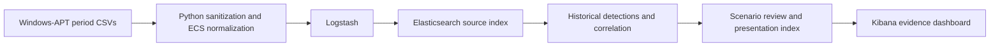

# ATTACK-Correlator

Reproducible detection and correlation of MITRE ATT&CK sub-techniques in
Windows-APT telemetry using Python, Elastic Security and Kibana.

The local pipeline inspects and normalizes the Windows-APT 2025 v4 dataset, runs
historical queries for **T1059.001 PowerShell**, **T1059.003 Windows Command Shell**
and **T1543.003 Windows Service**, correlates exact event relationships, and presents
the evidence in Kibana. No scheduled Security rules are installed.

## Implementation and saved results

Inspection, preprocessing, ingestion, detection, correlation, scenario review and
the dashboard are implemented. The saved evidence records:

| Evidence unit | Result |
|---|---:|
| Source observations | 102,011: 90,601 timed and 11,410 intentionally undated |
| Refined PowerShell / shell / service-create / service-config events | 290 / 172 / 41 / 108 |
| Broad / refined ordered pairs at 60, 300 and 900 seconds | 261 / 3 |
| Separately corroborated service-installation triples | 3 |
| Dashboard presentation documents / panels | 881 / 19 |

These are candidate observations and structural relationships, not confirmed attacks
or measured accuracy. Candidate-volume reduction does not establish false-positive
reduction. See [limitations](docs/limitations.md) and [evaluation](docs/evaluation.md).

The [documentation guide](docs/README.md) indexes maintained instructions.
[Saved analysis](analysis/README.md) explains the evidence snapshots and their recorded
validation times. Documentation review does not refresh those validation results.



Raw source data remains immutable. Source labels and derived scenario assignments are
context, never detection predicates or correlation keys. No dataset commands, publisher
attack scripts or malware are executed. See [architecture](docs/architecture.md).

## Prerequisites

- Python 3.12 or newer, with `venv` and `pip`.
- Docker Desktop using Linux containers on Windows, or Docker Engine on Linux.
- Docker Compose v2 supporting health-based dependencies and `--wait`.
- Git and internet access for the initial dependency/image downloads and dataset acquisition.
- A starting allocation of 8 GB Docker memory and 10 GB free disk; measure actual use.
- Available loopback ports 9200 and 5601, or adjusted ports in `.env`.

The stack pins Elasticsearch, Kibana and Logstash to **9.5.3** in `.env.example`.
The retained host verification was on Windows; a fresh Linux/macOS installation is
not established by the supplied Bash wrappers alone.

## 1. Set up the local environment

Run from the repository root:

```powershell
.\scripts\setup.ps1
```

On Bash use `bash scripts/setup.sh`. Setup creates `.venv`, installs the development
requirements and generates random credentials and stable encryption keys in ignored
`.env`. It preserves an existing configuration. If PowerShell script execution is
restricted, use the equivalent commands allowed by your environment:

```powershell
python -m venv .venv
.\.venv\Scripts\python.exe -m pip install -r requirements-dev.txt
.\.venv\Scripts\python.exe scripts/configure_env.py
docker compose config --quiet
```

For subsequent Python commands, Bash users should substitute `.venv/bin/python` for
`.\.venv\Scripts\python.exe`. Keep `.env`, certificates and datasets out of Git.
Changing `.env` does not reset the password stored in an existing Elasticsearch volume.

## 2. Acquire, inspect and normalize the dataset

Download [Windows-APT 2025, Mendeley Version 4](https://data.mendeley.com/datasets/b8fmtzvpy8/4)
(DOI `10.17632/b8fmtzvpy8.4`). The publisher lists CC BY 4.0. Retain its license,
README, checksums and scenario metadata. Prepare the downloaded ZIP using its actual path:

```powershell
.\.venv\Scripts\python.exe scripts/prepare_dataset.py "C:\path\to\Windows-APT-2025-v4.zip"
.\.venv\Scripts\python.exe scripts/verify_dataset.py "dataset/raw/windows-apt-2025-v4/Windows-APT 2025 A Dataset for APT-Inspired Attack"
.\.venv\Scripts\python.exe -m src.preprocessing.evidence_inventory
.\.venv\Scripts\python.exe -m src.preprocessing.preprocess
.\.venv\Scripts\python.exe -m src.preprocessing.verify_processed
```

The preparation helper extracts without running publisher scripts. The inventory
checks structured files, source roles, fields, timestamps, labels and joins. It writes
[dataset inventory](analysis/dataset_inventory.md), [coverage](analysis/attack_coverage.md),
[schema](analysis/dataset_schema.json), [mapping proposals](analysis/ecs_mapping_candidates.md)
and hash manifests. A full scan can take several minutes. `--reuse-schema` is available
only when cached input and schema-inspection code hashes match.

For an independent exploratory scan, use
`python -m src.preprocessing.inspect_dataset`; `--max-records 1000` deliberately produces
a partial scan with exit code 1. Exit code 0 means no reported scan problems, 1 means a
partial/problematic scan, and 2 means no supported inputs or a CLI usage error.

Normalization uses the period CSVs once, preserving `combined.csv` as separate evidence.
It writes `dataset/processed/windows-apt-events.ndjson` and schema/provenance sidecars.
The verifier reconstructs every original row and checks conservation and hashes.
Unresolved times stay absent rather than receiving invented UTC timestamps.
See [dataset notes](docs/dataset.md) and [sanitization policy](docs/sanitization.md).

## 3. Start Elastic and ingest

```powershell
docker compose up -d --wait --wait-timeout 360
docker compose ps -a
.\.venv\Scripts\python.exe scripts/check_stack.py
.\scripts\ingest.ps1
```

On Bash use `bash scripts/ingest.sh`. Initial image pulls can take several minutes.
The two initialization services exit successfully after provisioning certificates and
the Kibana service account. Open [local Kibana](http://localhost:5601) and sign in as
`elastic` with the password in `.env`. The browser endpoint uses HTTP on loopback;
Elasticsearch connections use certificate-verified HTTPS. This is a local lab.

The ingestion wrapper verifies processed data, installs the exact mapping, creates
`windows-apt-events-v1` if absent, runs Logstash and validates the resulting index.
Stable `event.id` values are Elasticsearch document IDs, so replay overwrites the same
records. `-Reset` / `--reset` deliberately deletes that index; ordinary replay does not
need it. `-TimeoutSeconds` / `--timeout` changes the default 1,200-second wait.

Ordinary Compose startup leaves ingestion input disabled. Restarting an enabled
Logstash input replays it; wait for drain before downstream validation. Undated events
remain searchable without a time filter. See the [ingestion runbook](docs/elastic-ingestion-and-validation.md).

Use `docker compose down` to stop while retaining named volumes. Adding `-v` resets
stored data, certificates and Kibana state.

## 4. Verify selection and run individual detections

```powershell
.\.venv\Scripts\python.exe scripts/validate_ingestion.py --output-directory analysis/detections/prerequisites
.\.venv\Scripts\python.exe scripts/inspect_technique_candidates.py
.\.venv\Scripts\python.exe scripts/inspect_selection_relationships.py
.\.venv\Scripts\python.exe scripts/verify_technique_selection.py
.\.venv\Scripts\python.exe scripts/run_individual_detections.py
```

The two inspection commands rebuild ignored projection caches and refresh provenance
on a fresh checkout/extraction or after re-ingestion. The separate ingestion replay
directory preserves the original report hash used by selection. Do not copy stale
caches or bypass a hash failure.

| Individual observation | Baseline → refined distinct events |
|---|---|
| [PowerShell](detections/technique-1/README.md) | 2,060 → 290 |
| [Windows Command Shell](detections/technique-2/README.md) | 7,717 → 172 |
| [Windows Service](detections/technique-3/README.md) | Create commands 155 → 41; configuration commands 117 → 108 |

The 102 SCM installation records and 708 registry observations are separate baselines,
not denominators for the sc.exe process variants. ES|QL predicates are authoritative;
KQL files are broad review filters. The runner executes 13 queries and checks complete
match sets and source evidence. See [methodology](docs/detection-methodology.md),
[runbook](docs/individual-detection-implementation.md) and [results](analysis/detections/detection-report.md).

## 5. Correlate events and build the scenario review

```powershell
.\.venv\Scripts\python.exe scripts/build_scenario_evidence.py
```

This command includes individual-detection and correlation replay, then verifies 621
source IDs and prepares the bounded review. To run correlation alone, use
`python scripts/run_correlation.py`; `--window 300` changes the selected window while
retaining the required 60/300/900-second checks.

Correlation requires exact host and process GUID ancestry with strictly ordered UTC
times. Complete enumeration retains 261 broad pairs and three refined pairs. Broad
EQL returns 222 sequences because of fan-out semantics; it is not the full denominator.
Three separate SCM installation records corroborate the refined interpreter pairs.

The scenario helper selects the earliest verified triple: DESKTOP-DS4FBF4 on
6 November 2024, spanning 41,801,900 ns. The review covers 11 units and 16 unique
events; two additional installations bring preserved scenario evidence to 18 records.
See [correlation](docs/correlation.md), [evaluation](docs/evaluation.md) and
[scenario evidence](analysis/scenarios/scenario-demonstration.md).

## 6. Build and validate the dashboard

```powershell
.\.venv\Scripts\python.exe scripts/build_dashboard_data.py
.\.venv\Scripts\python.exe scripts/build_dashboard.py
.\.venv\Scripts\python.exe scripts/validate_dashboard.py
```

Open [ATT&CK Detection & Correlation — Windows-APT 2025](http://localhost:5601/s/attack-correlator/app/dashboards#/view/attack-correlator-windows-apt-2025).
The 19 panels show exact cohort metrics, daily/host activity, ordered-pair volume,
the primary scenario and supporting evidence. The document table exposes the four
complete memberships (290/172/41/108) and links to original source events.

Panels retain **5 November–15 December 2024 UTC**. Overview/scenario panels stay fixed;
membership/search filters affect the detection evidence table. The
[export](kibana/dashboard.ndjson) contains saved objects, not source or presentation data.
See [dashboard guide](docs/dashboard.md), [build/visual validation](docs/kibana-dashboard-implementation.md)
and [import instructions](kibana/README.md).

## 7. Verify software and saved evidence

```powershell
.\.venv\Scripts\python.exe -m pytest -q --basetemp .test-tmp
.\.venv\Scripts\python.exe -m ruff check .
.\.venv\Scripts\python.exe -m ruff format --check .
.\.venv\Scripts\python.exe -m pip check
```

Software tests cover preservation, normalization, query contracts, exact counting,
correlation boundaries, fan-out, scenario selection and dashboard reconciliation.
They do not measure detector accuracy. Full source preservation is checked by
`python -m src.preprocessing.verify_processed`. Live ES|QL/EQL execution and source
readback require the earlier Elastic commands; saved reports retain their recorded
run times and validation scope.

## Report authoring and packaging

Follow [release preparation](docs/release-preparation.md) for optional PDF/Word authoring,
visual checks and release validation. Report authoring uses optional ReportLab, Pillow,
pypdf and python-docx libraries with Windows Arial fonts. Supply the reviewed source
at ignored `reports/technical-report.md` before rendering. Reports and their source
are excluded from the code archive.

```powershell
.\.venv\Scripts\python.exe scripts/package_release.py
```

The default ZIP is `reports/ATTACK-Correlator-code.zip`; `--output` must remain under
`reports/`. The packager reads Git-index blobs, so review and stage intended changes
before packaging. Unstaged and untracked files are not included. It checks forbidden
paths, local credential values, archive CRCs and member hashes. PDF/Word files and
the editable report source are delivered separately. Packaging requires a Git checkout.

## Troubleshooting

| Symptom | Action |
|---|---|
| Docker unavailable | Start Docker Desktop with Linux containers; check `docker info`. |
| Missing configuration or port conflict | Run `scripts/configure_env.py`; compare `.env` with `.env.example`, adjust ports and recreate services. |
| Kibana not ready | Check `docker compose ps -a` and `docker compose logs --tail 100 setup kibana elasticsearch`. |
| Bootstrap memory or `vm.max_map_count` error | Inspect Elasticsearch logs and [Elastic Docker host requirements](https://www.elastic.co/docs/deploy-manage/deploy/self-managed/install-elasticsearch-docker-prod). |
| Certificate error | Use the verified check script and local CA; do not disable script TLS verification. |
| Logstash idle | Ordinary startup disables input; run the ingestion wrapper. |
| No scheduled alerts | Use the historical runners; scheduled Security rules are not installed. |
| Missing historical events | Select an absolute historical range; remove the time filter for unresolved timestamps. |
| Selection cache/hash failure | Rebuild both inspection caches and verify selection; investigate input changes. |
| Fixed dashboard totals | Overview/scenario panels retain validated scope; use membership controls in the evidence table. |
| CSV/Unicode or partial-scan error | Read diagnostics and choose a verified delimiter/encoding; do not silently skip records. |
| Large JSON rejected by inspector | Its default limit is 64 MiB; review the input before raising `--max-json-mb`. |
| Test temporary-folder error | Use the directly creatable `--basetemp .test-tmp`. |
| Missing report source during rendering | Supply the reviewed `reports/technical-report.md`; it is not included in Git or the code archive. |
