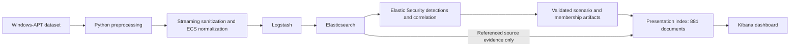

# Architecture

Inspection, preprocessing, ingestion, technique selection, individual detections,
historical correlation, scenario review and the Kibana dashboard are implemented.
No scheduled Security rules are installed.

Raw data stays immutable under `dataset/raw/`. The inspector writes separate
inventories under `analysis/inspection/`; it is not the preprocessing stage.
Normalization streams canonical period CSVs into provenance-preserving NDJSON, uses a
temporary SQLite index for scenario joins, and emits a mapping contract and conservation
reports. Pandas supports the inspection profiler; normalization uses strict Python
converters to retain raw spelling and avoid implicit type coercion.

Compose runs one Elasticsearch node, Kibana and Logstash. Two initialization
jobs provision local Elasticsearch TLS and the Kibana service password. Only
Elasticsearch (HTTPS) and Kibana (HTTP) publish loopback ports. The default node roles
include the transform role required by Elastic Security. Named volumes retain state.

The ingestion validation wrapper runs the existing full data normalization verifier, installs the unchanged
mapping inside `windows-apt-events-template`, creates the ordinary index
`windows-apt-events-v1` if needed, and enables the NDJSON file input. The processed
directory is mounted read-only; the 1.33 GB file is never added to a container image.
Logstash parses each line into a new event containing only the processed evidence,
removes runtime decorations and uses `event.id` as `_id`. Elasticsearch output uses
the existing credential environment and verifies the local CA.

The normal index permits absent `@timestamp`; a data stream would require one.
Valid timestamps retain nanosecond meaning and unresolved events stay undated.
The file input remains alive after EOF. Explicit runs replay all lines into the same
IDs, so reruns repair/overwrite the same corpus without duplicate inflation. Rejections
go to a run-specific file; Elasticsearch mapping rejections use the built-in Logstash
DLQ. No automatic source deletion or recovery queue processing is configured.

Live validation compares exact counts, the mapping contract, timestamp coverage,
representative telemetry queries and deterministic source samples. Run observations
and reports live under `analysis/ingestion/`. Source annotations and scenario labels
remain context for later review; they do not drive detection logic. See
[ingestion validation](elastic-ingestion-and-validation.md) for operational details and limits.

Individual detection executes single-record ES|QL against the ordinary historical index. Its manifest
keeps installation, service-command and registry cohorts separate. The runner verifies
exact match sets, fields and source evidence in bounded batches and writes results under
`analysis/detections/`. It does not change mappings or dataset timestamps. See
[individual detection](individual-detection-implementation.md) for analytical predicates and reproducible verification.

Event correlation executes EQL sequence views with request-local runtime fields and validates all
host/GUID/time tuples from complete source sets. Service installation objects are read
from preserved original evidence only. No extra index, mapping or runtime infrastructure
is installed. See [event correlation](event-correlation-validation.md) for exact units and EQL fan-out limitations.

Scenario evaluation verifies the primary and corroborating scenarios and emits a hashed evidence
contract. The presentation builder checks that contract, fetches 1,096 required source IDs, and builds
`attack-correlator-dashboard-v1`: 611 event-within-rule memberships, 261 ordered pairs
with exactly three refined flags, and nine event-within-triple rows. Deterministic IDs,
strict mapping ownership and complete readback prevent silent count drift. Source data
receives no writes. Service evidence and provenance remain disabled mapping objects;
analyst mappings occupy separate fields.

Kibana 9.5.3's public Dashboards API creates 19 inline panels in the
`attack-correlator` space. Metric aggregation filters preserve exact membership while
global filters are ignored; fixed panel time ranges preserve complete historical
evidence. A native Discover document table accepts a four-rule membership selector;
source-ID links resolve original events and explicit Discover links retain historical
cohorts. ES|QL chart layers reconcile by UTC day and host. The live export includes
the dashboard, referenced data view and space UTC configuration. A disposable space
verifies import, remapped IDs and equivalent panel results. See [dashboard implementation](kibana-dashboard-implementation.md).
